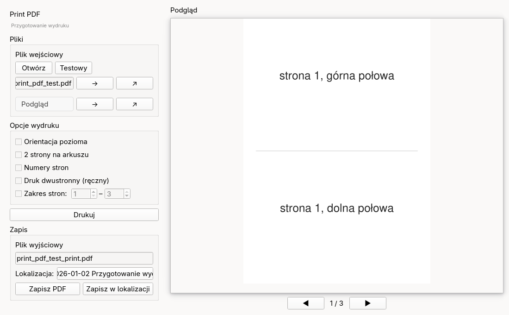
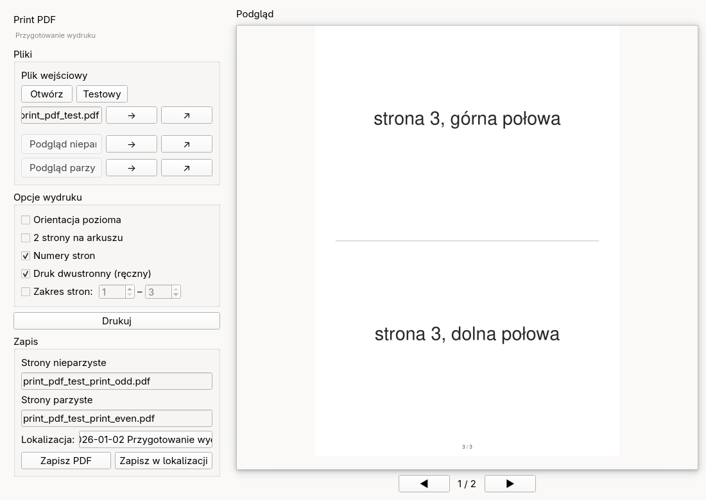

## Założenia

Chciałbym przygotować pdf gotowy do wydruku z możliwymi opcjami:

- druk dwustronny, ale na drukarce ręcznej. Czyli nieparzyste
  strony przygotować do jednego pliku, a parzyste do drugiego pliku, które będą
  drukowane osobno. Z tym że kolejność drukowania parzystych lub nieparzystych
  powinna być odwrócona, aby nie trzeba było ręcznie przekładać kartek. Trzeba też
  zwrócić uwagę, żeby jeśli liczba stron jest nieparzysta, dopełnić pustą stroną.
- dobrze by było móc dodać numer strony do wydruku.
- z opcją czy dwie czy jedna strona na stronie wydruku
- układ pionowy, czy poziomy

## Opcje komendy (CLI)

- `-i <input.pdf>` — plik wejściowy PDF
- `-o <output_name>` — bazowa nazwa pliku wyjściowego (bez rozszerzenia)
- `-d` — druk dwustronny ręczny (tworzy `_odd.pdf` i `_even.pdf`)
- `-n` — dodaje numery stron
- `-t` — 2 strony na arkuszu (2-up)
- `-l` — orientacja pozioma (landscape)

## Algorytm

Algorytm działa w kolejności:

1. Bierze pod uwagę ustawienie opcji `-l`
2. Jeśli jest opcja `-t`, przygotowuje dwie strony na jednej. Jeśli wyjściowym formatem
   jest landscape, ustawia strony obok siebie, w przeciwnym wypadku jedna nad drugą
3. Jeśli zaznaczona jest opcja `-n`, dodaje na marginesie dolnym numery stron
4. Jeśli zaznaczona jest opcja `-d`, układa strony w kolejności:
   - jeśli aktualna (nie oryginalnego dokumentu) liczba stron jest nieparzysta, dodaje
     na koniec pustą stronę
   - Odwraca kolejność stron parzystych
5. Zapisuje strony parzyste do jednego pliku, a nieparzyste do drugiego

## GUI

Poza linią komend, powinno być GUI.

### Wygląd okna

Okno podzielone jest na dwie kolumny:

**Lewa kolumna** (stała szerokość, przewijalna pionowo) zawiera kolejno:
- nagłówek „Print PDF / Przygotowanie wydruku"
- sekcję **Pliki**
- sekcję **Opcje wydruku**
- przycisk **Drukuj**
- sekcję **Zapis**

**Prawa kolumna** zajmuje pozostałą przestrzeń i zawiera:
- etykietę „Podgląd"
- obszar podglądu (przewijany, z cieniem)
- nawigację po stronach: `◀` numer `▶`

Zrzuty ekranu:

### Lewa kolumna — szczegóły

#### Sekcja Pliki

Zawiera trzy wiersze (każdy: etykieta statyczna + przycisk `→` + przycisk `↗`):

1. **Plik wejściowy** — nad polem z nazwą pliku dwa przyciski: `Otwórz` (otwiera
   dialog wyboru pliku) i `Testowy` (generuje testowy PDF). Pod nimi pole z nazwą
   wybranego pliku (nieedytowalne), oraz `→` i `↗`.
2. **Podgląd** (tryb simplex) lub **Podgląd nieparzyste** (tryb duplex).
3. **Podgląd parzyste** — widoczny tylko w trybie duplex.

Przyciski w każdym wierszu:
- `→` — przełącza podgląd na ten plik (aktywny przycisk podświetlony niebiesko)
- `↗` — otwiera plik w zewnętrznym programie (dla plików wyjściowych otwiera
  plik z `/tmp`; dla wejściowego — oryginał)

Tooltipy przycisków i pól pokazują nazwę pliku (bez ścieżki, z rozszerzeniem `.pdf`).

#### Sekcja Opcje wydruku

Checkboxy (każdy z tooltipem opisującym funkcję):
- **Orientacja pozioma** — landscape zamiast portrait
- **2 strony na arkuszu** — 2-up; w landscape obok siebie, w portrait jedna nad drugą
- **Numery stron** — dodaje numer na dolnym marginesie
- **Druk dwustronny (ręczny)** — włącza tryb duplex (pokazuje drugi wiersz w Plikach
  i drugie pole nazwy w Zapisie)
- **Zakres stron:** — checkbox + dwa spinboxy `od` / `do` (1-indeksowane);
  gdy zaznaczony, przetwarza tylko wybrane strony oryginału. Maksimum spinboxów
  ustawiane automatycznie po załadowaniu pliku.

#### Przycisk Drukuj

Nieaktywny dopóki nie załadowano pliku. Po kliknięciu:
- *Tryb simplex* — wyświetla komunikat „Drukuję dokument..." i wysyła plik do
  domyślnej drukarki (`lp`)
- *Tryb duplex* — drukuje najpierw strony parzyste, następnie wyświetla komunikat
  „Przekręć kartki na drukarce aby wydrukować strony nieparzyste" z przyciskami
  OK / Anuluj; po OK drukuje strony nieparzyste

#### Sekcja Zapis

- **Plik wyjściowy** (lub **Strony nieparzyste** w duplex) — edytowalne pole nazwy
  pliku z rozszerzeniem `.pdf`
- **Strony parzyste** — drugie pole, widoczne tylko w trybie duplex
- **Lokalizacja** — klikalny link pokazujący aktualny katalog zapisu; kliknięcie
  otwiera menedżer plików w tej lokalizacji. Domyślnie katalog roboczy aplikacji;
  po otwarciu pliku wejściowego zmienia się na katalog tego pliku
- **Zapisz PDF** — zapisuje w lokalizacji oryginalnego pliku (kopiuje z `/tmp`)
- **Zapisz w lokalizacji** — otwiera dialog wyboru katalogu, aktualizuje lokalizację,
  następnie zapisuje

### Podgląd

Przy każdej zmianie parametrów przetwarzany plik jest generowany do katalogu `/tmp`:
- `print_pdf_preview.pdf` (tryb simplex)
- `print_pdf_preview_odd.pdf` i `print_pdf_preview_even.pdf` (tryb duplex)

Podgląd wyświetla strony z tych plików — jest więc identyczny z tym, co zostanie
zapisane lub wydrukowane. Przycisk `↗` otwiera odpowiedni plik z `/tmp`.

Podgląd pliku wejściowego (`→` przy polu wejściowym) renderuje oryginał bez
przetwarzania.

Podgląd skaluje się do dostępnego miejsca i odświeża przy zmianie rozmiaru okna.

### Lokalizacja plików

Po otwarciu aplikacji, lokalizacją jest katalog roboczy (CWD).

Otwarcie pliku testowego **nie zmienia** lokalizacji.

Przycisk `Zapisz PDF` zapisuje w lokalizacji oryginalnego pliku.

Przycisk `Zapisz w lokalizacji` pozwala wybrać inny katalog przed zapisem.

### Plik testowy

Przycisk `Testowy` generuje testowy PDF z **3 stronami**.
Każda strona podzielona jest poziomą linią na dwie połowy.
W górnej połowie napis „strona N, górna połowa", w dolnej „strona N, dolna połowa"
(N = 1, 2, 3). Plik trafia do `/tmp/print_pdf_test.pdf`.
Otwarcie pliku testowego nie zmienia aktualnej lokalizacji zapisu.

## Technologia

- Python 3.10+
- PyMuPDF (`fitz`) — przetwarzanie PDF
- PyQt6 — GUI
- `uv` — zarządzanie środowiskiem i uruchamianie (`uv run print-pdf-gui`)
- `lp` (CUPS) — drukowanie
